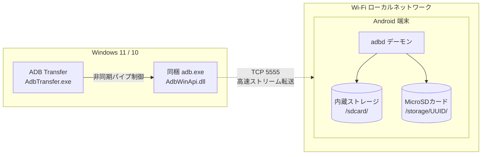

# ADB Transfer

**日本語** | [English](README_EN.md) | [简体中文](README_ZH.md)

Windows PC から Android 端末へ、Wireless ADB 経由で書籍・コミック・動画・PDF等の大容量データを高速・確実に転送する専用 Win32 ネイティブ GUI ツールです。

---

## 1. 概要と特徴

従来の MTP 接続で発生しやすい「フォルダだけ作成されて中身が0バイトになる」「無言切断」等の問題を根本解決し、Wi-Fi ローカルネットワーク経由で快適にファイル転送を行います。

- **USB 初回ワンクリック登録**: PC と USB 接続してボタンを1回押すだけで、Wi-Fi IP 取得から `tcpip 5555` の開放までを全自動化。以降は完全ワイヤレスで利用可能。
- **内蔵ストレージ ＆ 外付け MicroSD 自動判別**: `/sdcard` だけでなく、外付け MicroSD カード（UUID）も自動認識し、階層ツリーで探索可能。
- **ドラッグ＆ドロップ ＆ 完全マージ転送**: ファイル・フォルダをドロップするだけで、ターゲットディレクトリへ高速転送。同名フォルダ内の既存データを保護したままマージ。
- **完全サイズ照合（ベリファイ機能）**: `adb push` 完了後、Windows 側バイト数と Android 側バイト数（`stat -c %s`）を 1 バイト単位で厳密に照合。
- **多言語対応 (i18n: 日本語 / English / 简体中文)**:
  - 起動時に `lang/` ディレクトリ内の言語定義ファイルを動的スキャン。
  - 画面右下の言語セレクターからいつでもワンクリックで言語を切り替え可能（アプリの再起動不要）。
  - **新しい言語の追加手順**:
    1. `lang/en.json`（または `lang/ja.json`）をコピーし、ファイル名を目的の言語コード（例: 韓国語なら `ko.json`、フランス語なら `fr.json`、スペイン語なら `es.json`）に変更します。
    2. JSON 内の `"language_name"` をセレクターに表示したい言語名（例: `"한국어"`）に変更し、各テキストを翻訳します。
    3. アプリを起動すると、言語セレクターに新しい言語が自動的に追加されます（プログラムの修正や再コンパイルは一切不要です）。  
    *(※ 未翻訳のキーがある場合でもアプリがクラッシュすることはなく、`[MISSING: キー名]` として安全にフォールバック表示されます)*
- **単一ポータブル配布**: ランタイムインストール不要。GitHub Releases の ZIP を解凍するだけで即座に動作。

---

## バージョニング規則 (Versioning Policy)
本プロジェクトはセマンティックバージョニング（Semantic Versioning `MAJOR.MINOR.PATCH`）を採用しています。
- **タイトル表記**: `ADB Transfer v1.0.0`
- **第2数値 (MINOR / 機能追加)**: 新機能追加、UIコンポーネント追加、新規対応ストレージ方式など
- **第3数値 (PATCH / 機能修正)**: バグ修正、フリッカー抑制・描画最適化、文言修正など
- **第1数値 (MAJOR / メジャー)**: アーキテクチャの破壊的変更、主要通信プロトコルの刷新など



---

## 2. 使い方

### ステップ 1: 初回設定 (USB接続)
1. 端末側で「開発者向けオプション」を有効化し、「USBデバッグ」を ON にします。
2. PC と端末を USB ケーブルで接続します。
3. `AdbTransfer.exe` を起動し、上部の「**端末を登録 (USB)**」ボタンをクリックします。
4. 登録が完了すると、Wi-Fi IP が `config.ini` に自動保存され、ポート 5555 が開放されます。
5. USB ケーブルを取り外して構いません。

### ステップ 2: 日常的なワイヤレス転送
1. PC と端末が同一 Wi-Fi ネットワーク（または同一ルーター環境）にある状態で `AdbTransfer.exe` を起動します。
2. 自動的に Wi-Fi 経由で接続され、ステータスランプが緑色（●）になります。
3. 左側のツリービューから、内蔵ストレージまたは MicroSD カードの転送先フォルダを選択します。
   - 頻繁に使うフォルダは「**+ フォルダ登録**」でお気に入りに登録できます。
4. 右側のエリアに転送したいファイルまたはフォルダをドラッグ＆ドロップします。
5. 「**転送開始**」をクリックすると、バックグラウンド転送とサイズベリファイが実行されます。

---

## 3. ディレクトリ・構成ファイル一覧

```text
ADB Transfer/
├── bin/
│   ├── AdbTransfer.exe            # ビルド済み GUI アプリケーション本体
│   ├── lang/                      # 実行時多言語リソース
│   │   ├── ja.json                # 日本語辞書
│   │   ├── en.json                # 英語辞書
│   │   └── zh.json                # 簡体字中国語辞書
│   └── platform-tools/            # 動作に必要な Google 公式 Platform-Tools
├── doc/
│   ├── file_transfer_tool_specification.md  # 詳細仕様書
│   ├── task.md                              # タスク管理表
│   └── reviewer_report.md                   # QA & セキュリティ検証結果レビュー報告書
├── include/
│   ├── AdbManager.h               # ADB プロセス起動・パイプ制御
│   ├── ConfigManager.h            # config.ini 永続化
│   ├── DeviceManager.h            # 端末登録・接続状態管理
│   ├── I18nManager.h              # 多言語マネージャーヘッダー
│   ├── StorageScanner.h           # ストレージおよびディレクトリ走査
│   ├── TransferEngine.h           # 転送エンジンおよびサイズベリファイ
│   └── MainWindow.h               # Win32 GUI メインウィンドウ
├── lang/                          # 多言語リソース辞書 (JSON)
│   ├── ja.json                    # 日本語
│   ├── en.json                    # 英語 (English)
│   └── zh.json                    # 簡体字中国語 (简体中文)
├── src/                           # 上記ヘッダーの実装ソースコード
├── tests/                         # 単体テストスイート (4/4 全件合格)
├── Release/                       # GitHub Release 配布用パッケージ一式
│   ├── AdbTransfer.exe
│   ├── adb.exe
│   ├── AdbWinApi.dll
│   ├── AdbWinUsbApi.dll
│   ├── lang/
│   │   ├── ja.json
│   │   ├── en.json
│   │   └── zh.json
│   └── README.txt
├── README.md                      # 日本語ドキュメント (本文書)
├── README_EN.md                   # 英語ドキュメント (English)
└── README_ZH.md                   # 簡体字中国語ドキュメント (简体中文)
```

*(※ 開発用内部仕様書・タスク管理・レビュー報告書などの `doc/` フォルダおよび一時作業領域 `scratch/` は、Git 管理対象外 (`.gitignore`) として安全にローカル保護されています)*
