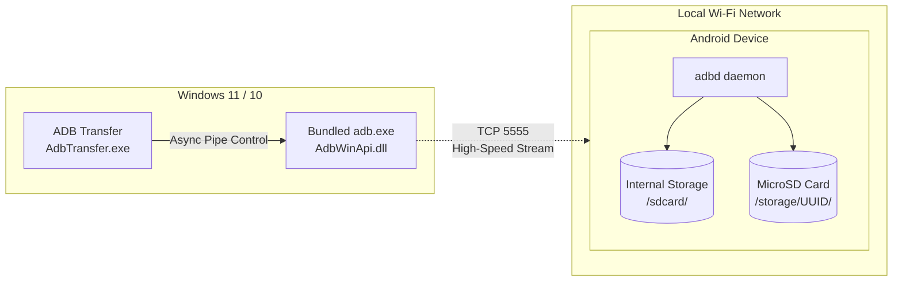

# ADB Transfer

[日本語](README.md) | **English** | [简体中文](README_ZH.md)

A dedicated native Win32 GUI tool designed to transfer large files (books, comics, videos, PDFs, etc.) from a Windows PC to an Android device quickly and reliably via Wireless ADB.

---

## 1. Overview and Key Features

Solves fundamental issues commonly encountered with traditional MTP connections, such as "folders created with 0-byte contents" and silent disconnections, providing smooth file transfers over your local Wi-Fi network.

- **One-Click Initial USB Setup**: Connect your device via USB and click once to automate Wi-Fi IP retrieval and open port `tcpip 5555`. Afterwards, operate completely wire-free.
- **Internal Storage & External MicroSD Auto-Detection**: Automatically discovers both `/sdcard` and external MicroSD cards (UUID), allowing hierarchical folder browsing.
- **Drag & Drop with Directory Merge**: Simply drag and drop files or folders into the target directory for high-speed transfer. Merges into existing folders without overwriting unrelated data.
- **Byte-Exact Size Verification**: After each `adb push`, strictly verifies local file sizes against Android remote file sizes (`stat -c %s`) down to the exact byte.
- **Multilingual Support (i18n: 日本語 / English / 简体中文)**:
  - Dynamically scans the `lang/` directory on startup.
  - Instantly switch languages from the dropdown selector in the bottom-right corner without restarting the app.
  - **Adding a New Language**:
    1. Copy `lang/en.json` (or `lang/ja.json`) and rename it to your target language code (e.g., `ko.json` for Korean, `fr.json` for French, `es.json` for Spanish).
    2. Change `"language_name"` inside the JSON to your desired display name (e.g., `"한국어"`), and translate the string values.
    3. Launch the application; the new language will automatically appear in the selector dropdown (no recompilation or source code changes needed!).  
    *(※ Missing translation keys safely fall back to `[MISSING: key_name]` without crashing)*
- **Single Portable Distribution**: No runtime installation required. Simply extract the ZIP from GitHub Releases and run.

---

## Versioning Policy
This project adheres to Semantic Versioning (`MAJOR.MINOR.PATCH`).
- **Title Display**: `ADB Transfer v1.0.0`
- **Second Number (MINOR / Feature Additions)**: New feature additions, UI component additions, new storage format support, etc.
- **Third Number (PATCH / Bug Fixes & Refinements)**: Bug fixes, flicker reduction/rendering optimizations, text corrections, etc.
- **First Number (MAJOR / Major Changes)**: Breaking architectural changes or complete protocol overhaul.



---

## 2. How to Use

### Step 1: Initial Setup (USB Connection)
1. On your device, enable "Developer options" and turn on "USB debugging".
2. Connect your device to your PC using a USB cable.
3. Launch `AdbTransfer.exe` and click the "**Register Device (USB)**" button at the top.
4. Once registered, the Wi-Fi IP address is saved to `config.ini` and port 5555 is opened.
5. You can now disconnect the USB cable.

### Step 2: Daily Wireless Transfers
1. Launch `AdbTransfer.exe` while your PC and device are connected to the same Wi-Fi network (or router).
2. The app automatically connects via Wi-Fi, and the status indicator turns green (●).
3. In the tree view on the left, select the destination folder on Internal Storage or the MicroSD card.
   - You can bookmark frequently used folders using "**+ Add Folder**".
4. Drag and drop the files or folders you wish to transfer into the transfer area on the right.
5. Click "**Start Transfer**" to begin background streaming and automatic size verification.

---

## 3. Directory Structure

```text
ADB Transfer/
├── bin/
│   ├── AdbTransfer.exe            # Built GUI application binary
│   ├── lang/                      # Runtime multilingual resources
│   │   ├── ja.json                # Japanese dictionary
│   │   ├── en.json                # English dictionary
│   │   └── zh.json                # Simplified Chinese dictionary
│   └── platform-tools/            # Google official Platform-Tools
├── doc/
│   ├── file_transfer_tool_specification.md  # Detailed technical specification
│   ├── task.md                              # Task tracking sheet
│   └── reviewer_report.md                   # QA & Security review report
├── include/
│   ├── AdbManager.h               # ADB process execution & pipe control
│   ├── ConfigManager.h            # config.ini persistence
│   ├── DeviceManager.h            # Device registration & state tracking
│   ├── I18nManager.h              # Multilingual manager header
│   ├── StorageScanner.h           # Storage and directory scanner
│   ├── TransferEngine.h           # Transfer engine & byte-level verification
│   └── MainWindow.h               # Win32 GUI main window
├── lang/                          # Multilingual resource dictionary (JSON)
│   ├── ja.json                    # Japanese
│   ├── en.json                    # English
│   └── zh.json                    # Simplified Chinese
├── src/                           # Source code implementations
├── tests/                         # Unit test suite (4/4 passed)
├── Release/                       # GitHub Release distribution package
│   ├── AdbTransfer.exe
│   ├── adb.exe
│   ├── AdbWinApi.dll
│   ├── AdbWinUsbApi.dll
│   ├── lang/
│   │   ├── ja.json
│   │   ├── en.json
│   │   └── zh.json
│   ├── LICENSE-Apache-2.0.txt     # Apache License 2.0 full text for ADB
│   ├── NOTICE-adb.txt             # AOSP copyright notice file for ADB
│   └── README.txt
├── README.md                      # Japanese documentation
├── README_EN.md                   # English documentation (This file)
└── README_ZH.md                   # Simplified Chinese documentation
```

*(※ Internal development documents, tasks, reviewer reports in `doc/`, and temporary scripts in `scratch/` are excluded from Git tracking via `.gitignore` to keep the public repository clean and secure)*

---

## 8. License

- **ADB Transfer**: MIT License
- **Android Debug Bridge (`adb.exe`, `AdbWinApi.dll`, `AdbWinUsbApi.dll`)**:  
  Binaries built from the Android Open Source Project (AOSP) and redistributed under the [Apache License, Version 2.0](Release/LICENSE-Apache-2.0.txt). For attribution and copyright notices, see [Release/NOTICE-adb.txt](Release/NOTICE-adb.txt).

