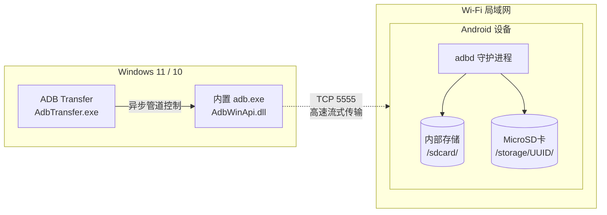

# ADB Transfer

[日本語](README.md) | [English](README_EN.md) | **简体中文**

专为从 Windows PC 通过 Wireless ADB 快速、可靠地将书籍、漫画、视频、PDF 等大容量文件传输至 Android 设备而设计的原生 Win32 GUI 桌面工具。

---

## 1. 概述与核心特性

从根本上解决传统 MTP 模式下经常出现的“创建了空文件夹但内容为0字节”、“莫名静默断开”等痛点问题，通过 Wi-Fi 局域网实现流畅高效的文件传输。

- **USB 首次一键注册**: 将设备通过 USB 连接电脑后只需点击一次，自动完成 Wi-Fi IP 获取并开启 `tcpip 5555` 端口。之后即可完全无线使用。
- **内部存储与外置 MicroSD 卡自动识别**: 不仅支持 `/sdcard`，还能自动检测外置 MicroSD 卡（UUID）并提供树状目录层级浏览。
- **拖拽添加与目录智能合并**: 直接将文件或文件夹拖入传输区域即可高速传输。自动合并至目标目录，完整保护已有文件。
- **完整目录结构还原与展开式文件选择 (v1.1.0)**:
  - 传输列表中的文件夹支持点击 `> ` 展开，可单独勾选想要传输的子文件。
  - 在设备端通过 `mkdir -p` 完美重现本地目录层级结构，杜绝散落至根目录问题。
- **实时传输速度与总体进度显示 (v1.2.0)**:
  - 基于传输进度与高精度定时器，实时计算瞬间传输速度（`MB/s` / `KB/s`）及总体完成百分比（`总体 XX%`）并显示于状态栏。
- **传输途中随时停止（中断）功能 (v1.2.0)**:
  - 传输过程中，开始按钮自动切换为“停止”按钮，用户可随时安全中断传输任务。
- **校验成功文件即时出队与自动保存 (v1.2.0)**:
  - 每当单个文件传输并大小校验成功后，立即从传输列表中移除并实时同步至 `config.ini`。即使中途停止，队列中也只保留未传输文件，便于下次立即无缝继续。
- **目标路径 INI 最优先保持与隐式树形选择防误触 (v1.2.1)**:
  - 防止传输完成弹窗关闭或启动后台扫描结束时，树形控件因获得焦点隐式自动选中首项（`/sdcard`）而覆盖配置。始终优先保留 `config.ini` 中上次记录的目标目录。
- **异步校验流水线化与目录缓存 (v1.2.2)**:
  - 在后台异步执行上一文件的完整性校验，同时立即启动下一文件的传输，有效缩短文件间切换等待时间。通过目录缓存彻底消除多文件同目录下重复 `mkdir` 的通信开销。
- **磁盘物理写入等待状态明确显示 (v1.2.2)**:
  - 进度达 95%（等待终端物理闪存刷新落盘）时，底部状态栏明确显示“正在等待写入磁盘完成...”，消除卡死假象与顾虑。
- **完全文件大小精确校验**: 每次 `adb push` 完成后，以 1 字节为单位严格比对 Windows 本地与 Android 远端（`stat -c %s`）文件大小，强化转义处理完美支持包含括号 `[...]` 的特殊路径。
- **多语言国际化支持 (i18n: 日本語 / English / 简体中文)**:
  - 启动时自动扫描 `lang/` 目录中的语言定义文件。
  - 通过界面右下角的下拉菜单随时一键切换语言（无需重启应用）。
  - **添加新语言步骤**:
    1. 复制 `lang/en.json`（或 `lang/ja.json`），将文件名重命名为目标语言代码（例如韩语为 `ko.json`，法语为 `fr.json`，西班牙语为 `es.json`）。
    2. 将 JSON 中的 `"language_name"` 修改为您希望在下拉菜单中显示的语言名称（如 `"한국어"`），并翻译各项文本。
    3. 启动应用后，新语言将自动显示在语言选择器中（无需修改任何代码或重新编译！）。  
    *(※ 若存在未翻译的词条，应用不会崩溃，会自动安全回退显示为 `[MISSING: 键名]`)*
- **单文件绿色便携分发**: 无需安装任何额外运行库。解压 GitHub Releases 的 ZIP 即可直接运行。

---

## 版本控制规则 (Versioning Policy)
本项目遵循语义化版本控制规范（Semantic Versioning `MAJOR.MINOR.PATCH`）：
- **标题显示**: `ADB Transfer v1.2.2`
- **第2位数值 (MINOR / 功能增加)**: 新增功能、新增 UI 组件、新增存储格式支持等
- **第3位数值 (PATCH / 功能修复)**: 缺陷修复、消除闪烁/界面渲染优化、文本修正等
- **第1位数值 (MAJOR / 主版本更新)**: 架构破坏性变更、核心通信协议重构等



---

## 2. 使用方法

### 步骤 1: 首次配对设置 (USB连接)
1. 在设备上开启“开发者选项”并启用“USB 调试”。
2. 使用 USB 数据线将设备连接至 PC。
3. 打开 `AdbTransfer.exe`，点击顶部的“**注册设备 (USB)**”按钮。
4. 注册完成后，Wi-Fi IP 地址将自动保存至 `config.ini`，并开放端口 5555。
5. 此时可断开并拔下 USB 数据线。

### 步骤 2: 日常无线文件传输
1. 确保 PC 与设备处于同一 Wi-Fi 网络（或同一路由器环境下），启动 `AdbTransfer.exe`。
2. 应用将自动通过 Wi-Fi 连接，状态指示灯变为绿色（●）。
3. 在左侧树状视图中选择内部存储或 MicroSD 卡上的目标文件夹。
   - 常用文件夹可点击“**+ 添加文件夹**”保存为快捷预设。
4. 将要传输的文件或文件夹拖拽至右侧传输列表。
5. 点击“**开始传输**”，即刻开始后台传输并执行严格的文件大小校验。

---

## 3. 目录与文件结构

```text
ADB Transfer/
├── bin/
│   ├── AdbTransfer.exe            # 编译生成的 GUI 应用程序
│   ├── lang/                      # 运行时多语言资源
│   │   ├── ja.json                # 日语字典
│   │   ├── en.json                # 英语字典
│   │   └── zh.json                # 简体中文字典
│   └── platform-tools/            # 运行所需的 Google 官方 Platform-Tools
├── doc/
│   ├── file_transfer_tool_specification.md  # 详细规格说明书
│   ├── task.md                              # 任务进度管理表
│   └── reviewer_report.md                   # QA与安全审查报告
├── include/
│   ├── AdbManager.h               # ADB 进程管道控制
│   ├── ConfigManager.h            # config.ini 持久化
│   ├── DeviceManager.h            # 设备注册与连接状态管理
│   ├── I18nManager.h              # 多语言管理器头文件
│   ├── StorageScanner.h           # 存储设备与目录遍历
│   ├── TransferEngine.h           # 传输引擎与字节校验
│   └── MainWindow.h               # Win32 GUI 主窗口
├── lang/                          # 多语言资源字典 (JSON)
│   ├── ja.json                    # 日语
│   ├── en.json                    # 英语 (English)
│   └── zh.json                    # 简体中文
├── src/                           # 源代码实现
├── tests/                         # 自动化单元测试套件 (4/4 全项通过)
├── Release/                       # GitHub Release 分发包
│   ├── AdbTransfer.exe
│   ├── adb.exe
│   ├── AdbWinApi.dll
│   ├── AdbWinUsbApi.dll
│   ├── lang/
│   │   ├── ja.json
│   │   ├── en.json
│   │   └── zh.json
│   ├── LICENSE-Apache-2.0.txt     # ADB 专用的 Apache 2.0 许可证全文
│   ├── NOTICE-adb.txt             # ADB 专用的 AOSP 版权声明告知文件
│   └── README.txt
├── README.md                      # 日语文档
├── README_EN.md                   # 英语文档 (English)
├── README_ZH.md                   # 简体中文文档 (本文档)
└── TRANSFER_SPEED_ANALYSIS.md     # 无线 ADB 传输速度技术规格与瓶颈分析书
```

*(※ 内部开发规格说明、任务进度管理、审查报告等 `doc/` 目录以及临时脚本目录 `scratch/` 均已通过 `.gitignore` 排除在 Git 追踪之外，确保公开仓库的整洁与安全)*

---

## 8. 开源许可 (License)

- **ADB Transfer**: MIT License
- **Android Debug Bridge (`adb.exe`, `AdbWinApi.dll`, `AdbWinUsbApi.dll`)**:  
  源自 Android Open Source Project (AOSP) 的二进制分发组件，依据 [Apache License, Version 2.0](Release/LICENSE-Apache-2.0.txt) 捆绑再分发。有关归属及版权声明，请参阅 [Release/NOTICE-adb.txt](Release/NOTICE-adb.txt)。

